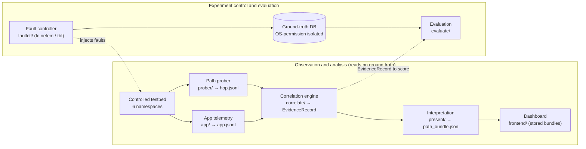
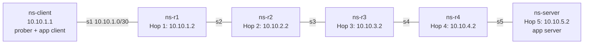
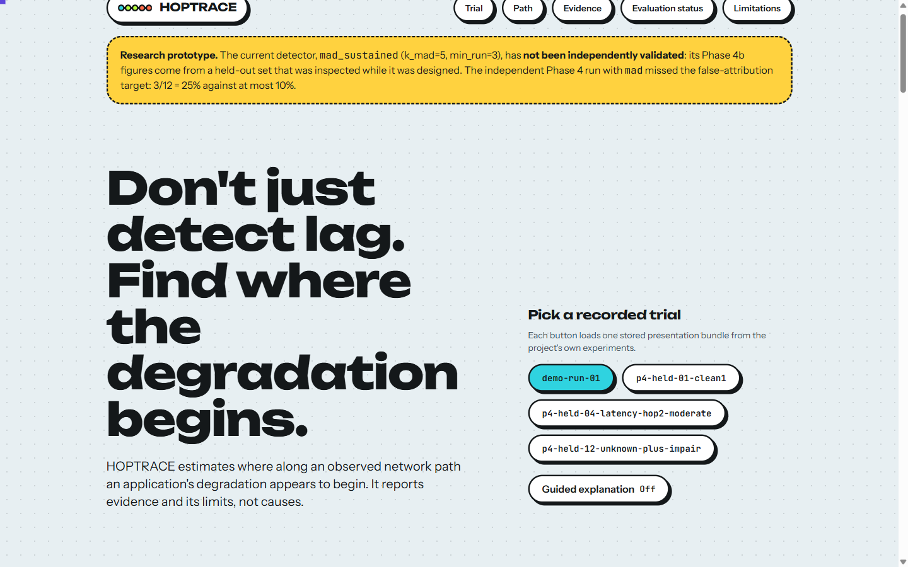
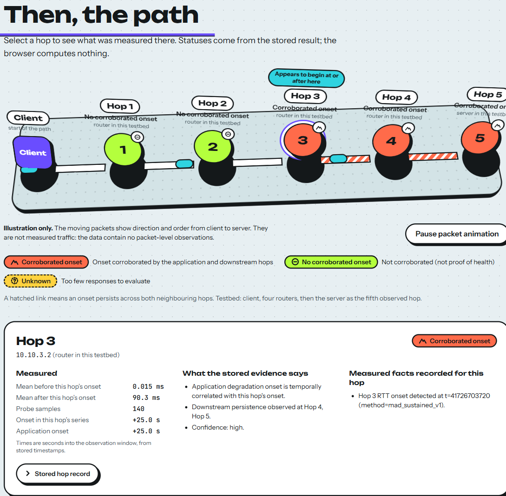

# HOPTRACE: Network Path Fault Localization through Application-to-Hop Correlation

When an application slows down, HOPTRACE asks: *where along the observed
network path does the degradation first appear?* It measures the path hop by
hop and the application's own round-trip time on one shared clock, detects
when each series starts to behave abnormally, and reports the earliest hop
whose onset lines up with the application's, in evidence-bounded language
only ("Degradation appears to begin at or after Hop N"). It never claims that
a particular router *caused* anything.

It is a Computer Networks research project, not a monitoring dashboard, speed
test or traceroute wrapper.

| | |
|---|---|
| **Student / sole author** | Krish Chirag Shah, registration no. **24BCE0624** |
| **Course** | BCSE308P: Computer Networks Lab (Innovative Evaluation Practices) |
| **Slot / team** | **F2 / Team 24** |
| **Repository** | https://github.com/KrishUsesGit/F2_Team24 |
| **Submission** | VTOP: Assignment 8 (report PDF), Assignment 9 (presentation), Assignment 10 (this repository) |

## Deliverables in this repository

| Deliverable | Path |
|---|---|
| Project report (PDF, 44 pages) | [`submission/F2_Team24_Report.pdf`](submission/F2_Team24_Report.pdf) |
| Project presentation (PPTX, 18 slides) | [`submission/F2_Team24_PPT.pptx`](submission/F2_Team24_PPT.pptx) |
| Genuine dashboard screenshots | [`submission/screenshots/`](submission/screenshots/) |
| Measured-data figures | [`submission/figures/`](submission/figures/) |
| Scripts that rebuild the report, figures and deck | [`submission/build/`](submission/build/) |

## Scientific status: read this first

- The engineering is complete enough to run end to end on a controlled
  testbed, with ground-truth isolation enforced by OS permissions.
- **The localization algorithm is not independently validated.** The only
  independent held-out run (Phase 4, detector `mad`) **missed** the
  false-attribution limit: 3/12 = 25% against a ≤10% maximum. The later
  Phase 4b configuration (`mad_sustained`) met the numeric thresholds
  (1/12 = 8.3%), but on the *same* held-out set after its traces had been
  inspected during design, so that result is a historical record, **not**
  independent validation. See [`docs/EVIDENCE_LEDGER.md`](docs/EVIDENCE_LEDGER.md).
- Loss and bandwidth faults are not localized (0 of 4 on the exposed
  held-out set, 0 of 4 on the Phase 4b tuning set). Bandwidth observability
  with the current probe load is unproven.
- The confidence level is a fixed heuristic, not a calibrated probability.
- Unknown hops are not assumed healthy, and timing correlation does not
  establish causation.
- "No significant degradation was detected" means no onset was detected; it
  does not exclude a fault that covers most of the observation window.

## Problem statement and objectives

`ping` and `traceroute` describe the path but not what an application
experienced; application monitoring sees the symptom but not the path.
HOPTRACE joins the two on one clock to estimate **where along an observed path
the application's degradation appears to begin**.

1. Build a reproducible testbed with a known path and injectable faults.
2. Measure path hops and application RTT on one shared clock.
3. Detect onsets, align them in time, and report evidence-bounded results.
4. Keep ground truth out of the engine's reach and score results afterwards.
5. Display stored results in a dashboard that does not recompute them.
6. Evaluate on separate tuning and held-out sets, and disclose the misses.

## Key features

- Six-namespace Linux testbed (client, four routers, server), five measurable hops.
- Raw-socket TTL prober (TCP-SYN default, UDP optional) and a hand-written
  RFC 6455 WebSocket application (20 Hz ping stream).
- Fault controller (`tc netem` / `tbf`) with ground truth in a permission-isolated store.
- Correlation engine: 500 ms buckets, median/MAD onset detection (3 buckets in a row),
  alignment within 1.5 s with downstream persistence, typed evidence (`fact`,
  `inference`, `correlation`, `confidence`, `unknown`).
- Locked, evidence-bounded result sentences; causal phrases are asserted out in code.
- React + TypeScript dashboard over stored results, with an optional guided explanation.
- 117 Python unit tests, 310 frontend tests, real-browser layout and interaction checks.
- **No third-party Python packages**: everything on the Python side is the standard library.

## System architecture



Data contract between stages: `hop.jsonl` + `app.jsonl` → `EvidenceRecord`
(produced by `correlate/evidence.py`) → `path_bundle.json`
(`present/path_bundle.py`; the dashboard's data). There is no JSON Schema file
or version field yet; the frontend validates bundles with a Zod schema.

## Network topology



Subnet *N* is `10.10.N.0/30` (lower node `.1`, higher node `.2`). A fault "at
hop N" is applied to the egress interface of `ns-rN` (the link *leaving* Hop N),
so the first hop that can show it is **N+1**; the evaluation scores against
`min(N+1, 5)`. Names and addresses come from
[`testbed/phase0/lib/common.sh`](testbed/phase0/lib/common.sh).

## Technologies

| Part | What is used |
|---|---|
| Testbed and measurement | WSL2 Ubuntu 24.04, Python 3.12 (standard library only), iproute2 6.1 (`ip netns`, `tc netem/tbf`), raw sockets, SQLite (stdlib) |
| Dashboard | React 19, TypeScript (strict), Vite 8, Tailwind CSS 4, Motion, Zod; self-hosted fonts |
| Dashboard verification (optional) | Vitest, Testing Library, jsdom, axe-core, ESLint + jsx-a11y, Chrome or Edge for the browser checks |
| Documentation build (optional) | matplotlib, python-pptx, PyMuPDF, a Chromium browser (only to regenerate `submission/`) |

## Prerequisites

| For | You need | Verified on |
|---|---|---|
| Testbed, probing, telemetry, Python tests | **WSL2 Ubuntu 24.04** (or an equivalent Linux with network namespaces), Python 3.12, iproute2, `traceroute`, root/`sudo` | Windows 11 + WSL2 Ubuntu 24.04, kernel 6.18.33.2, Python 3.12.3, iproute2 6.1.0 |
| Dashboard | **Node ≥ 22.12** and npm | Windows 11, Node 24.14.1, npm 11.11.0 |

Windows-native Python is **not** supported (the code uses
`time.clock_gettime_ns` and Linux network namespaces). Native Linux, macOS and
other Node/Python versions have **not** been verified.

Things to know before you start:

- Raw sockets, namespaces and `tc` need root. Network namespaces and `tc` state
  are **lost whenever WSL restarts**; rebuild the topology each session.
- The ground-truth database lives at `/var/lib/hoptrace/groundtruth.db` on the
  native Linux filesystem, **not** in this repository. `/mnt/c` (drvfs) ignores
  `chmod`, so it cannot enforce the isolation; do not move the DB there.
- Clone to an ordinary path. A OneDrive-synced folder risks sync conflicts and
  locks on `.git` and `node_modules`. Inside WSL, `~/hoptrace` is preferable to `/mnt/c/...`.
- `.gitattributes` forces LF for source files and stores evidence byte-for-byte.
  The `.sh` scripts must stay LF.

## Installation

```bash
git clone https://github.com/KrishUsesGit/F2_Team24.git F2_Team24
cd F2_Team24
```

Python needs no installation step. For the dashboard:

```bash
cd frontend
npm ci          # installs exactly what package-lock.json records
```

## Run the unit tests (safe, no root)

From the repository root, in WSL2, as an **unprivileged** user (the `faultctl`
tests mock `tc` and patch the DB path to a temporary directory, but running
unprivileged additionally guarantees the real ground-truth DB cannot be written):

```bash
for d in prober/tests app/tests correlate/tests evaluate present/tests faultctl/tests; do
  PYTHONDONTWRITEBYTECODE=1 python3 -B -m unittest discover -s "$d" -p 'test_*.py' || break
done
python3 tools/check_repo_hygiene.py
```

**Expected:** six `OK` blocks (`Ran 9`, `10`, `38`, `16`, `29`, `15` tests: 117 in total), then
`OK: no per-user paths, no CR characters, .gitattributes present`. The `faultctl`
tests print a stray event UUID; that is expected.

## Build and verify the testbed (modifies the WSL system: read first)

```bash
# as root in WSL2 (prefix with sudo), from the repository root
bash faultctl/setup_identities.sh        # idempotent. Creates system users hoptrace-truth /
                                         # hoptrace-engine / hoptrace-eval, /var/lib/hoptrace (0750),
                                         # and /etc/sudoers.d/hoptrace-truth (tc in ns-r1..ns-r4 only)
bash testbed/phase0/teardown_topology.sh # safe if nothing exists
bash testbed/phase0/setup_topology.sh    # NOT idempotent: run teardown first
bash testbed/phase0/verify_topology.sh   # connectivity + hop-order checks
```

**Expected** (observed on 27 Oct 2026): `topology up.`; `icmp_ratelimit calibration: 0 (ns-r1, expect 0)`;
`200 packets transmitted, 200 received, 0% packet loss` with `PASS`; the hop sequence
`10.10.1.2 10.10.2.2 10.10.3.2 10.10.4.2 10.10.5.2` twice with `PASS`.

## Run the live demo

```bash
# as root in WSL2, from the repository root
bash demo/run_demo.sh
```

It rebuilds the topology, verifies that `hoptrace-engine` cannot read the
ground-truth DB, injects a real 90 ms latency fault with `faultctl`, runs the
frozen detector as `hoptrace-engine`, writes `experiments/demo-run-01/`
(**overwriting it**: copy it first if you want to keep the recorded trial), then
removes the fault and measures recovery. Known limits are in
[`demo/demo_script.md`](demo/demo_script.md): the demo runs in the detector's
favourable regime (fault covers a minority of the window), writes its trial
label into `trial_meta.json`, and has no cleanup trap if it fails midway.

**Expected:** `Degradation appears to begin at or after Hop 3.`, confidence high,
corroborating Hops 3, 4, 5; Hop 3 RTT about 78 ms under the fault and about 0.01 ms after
clearing. The recorded `demo-run-01` shows exactly this.

## How to select or run experiments

- **Recorded trials** are in `experiments/` (40 directories; their status is in
  [`docs/EVIDENCE_LEDGER.md`](docs/EVIDENCE_LEDGER.md)). The dashboard lists those that have a `path_bundle.json`.
- **Your own trial** (on a built testbed, as root unless noted; derived from the scripts' argument
  parsers, not exercised for the submission):

```bash
mkdir -p experiments/my-trial
ip netns exec ns-server python3 app/server.py --host 0.0.0.0 --port 8765 &
ip netns exec ns-client python3 prober/prober.py --dst 10.10.5.2 --src 10.10.1.1 --transport tcp_syn \
    --rounds 70 --interval 0.5 --out experiments/my-trial/hop.jsonl &
ip netns exec ns-client python3 app/client.py --host 10.10.5.2 --port 8765 --duration 35 \
    --out experiments/my-trial/app.jsonl &
# after ~25 s inject a fault (hop 1-4; latency | jitter | loss | bandwidth) as the controller identity:
su -s /bin/bash hoptrace-truth -c "cd faultctl && python3 controller.py inject --hop 2 --type latency --delay-ms 90 --trial-id my-trial"
# when the trial ends:
su -s /bin/bash hoptrace-truth -c "cd faultctl && python3 controller.py clear-latest --hop 2 --trial-id my-trial"
```

  Analyse with the frozen configuration by mirroring steps 5-6 of `demo/run_demo.sh`
  (`demo/_run_engine_pipeline.py`, then `present/path_bundle.py`).

## View the dashboard

```bash
cd frontend
npm run verify      # typecheck, lint, test, build, verify:dist
npm run preview     # serves dist/ at http://127.0.0.1:4173/
```

Open `http://127.0.0.1:4173/`. `npm run dev` serves the same allowlisted data in
development. The page must be served by `vite` (opening `index.html` directly does
not load data), and the server must keep running; if it stops, every trial fails
with "The data files could not be reached". Keep `frontend/` inside the repository
checkout: it reads `../experiments` and `../evaluate` at build time. More detail:
[`frontend/README.md`](frontend/README.md). The older static page in `ui/` (CDN fonts, three
trials) is kept for history only (`python3 -m http.server 8420`, then `/ui/index.html`).

| Trial picker and guided toggle | Path and hop inspector |
|---|---|
|  |  |

More captures (RTT chart, unknown hops, evidence, guided explanation, stored evaluation,
limitations) are in [`submission/screenshots/`](submission/screenshots/). Moving packets in the
3-D path are **illustrative only**; the data contain no packet-level observations.

## How to run all tests

| Layer | Command | Result on 27 Oct 2026 |
|---|---|---|
| Python unit tests | the loop above (WSL2) | 117 tests OK |
| Hygiene | `python3 tools/check_repo_hygiene.py` | OK |
| Frontend | `cd frontend && npm run verify` | typecheck, lint (0 warnings), 310 tests, build, `verify:dist` all pass |
| Browser | `npm run check:layout`, `npm run check:preview` (need Chrome/Edge) | 40 layout checks OK; 4 trials switched in one session, packet pause and guided walkthrough OK |
| Testbed | `verify_topology.sh` | 200/200 packets; 5 hops in order |

## Experimental findings and limitations

| Metric (12 held-out trials) | Phase 4 `mad` (independent) | Phase 4b `mad_sustained` (**exposed** set) |
|---|---|---|
| **False attribution** (target ≤ 10%) | **3/12 = 25%, target missed** | 1/12 = 8.3% (not independent validation) |
| Clean-control false positives | 2/4 | 0/4 |
| Within ±1 hop (localized trials) | 3/3 | 4/4 (95% CI 51-100%) |
| Exact first hop (localized trials) | 2/3 | 3/4 |
| Recall of injected faults | 3/8 | 4/8 |
| Brier score | 0.432 (n = 5) | 0.040 (n = 4) |

Latency and jitter were localized when a claim was made; **no loss or bandwidth trial was
localized**. All sets are tiny (12, 12 and 10 trials against a specified 120-trial tuning
set), the 1.5 s alignment window is unvalidated, and the sealed evaluation (spec Phase 5)
was never run. Full tables, per-trial outcomes and the limitations list are in the report.

## Phases (the locked specification's numbering)

Authoritative spec: `hoptrace-phase-0-5-spec.html`.

| Phase | Content | In this repo |
|---|---|---|
| 0 | Controlled testbed (6 Linux network namespaces) | `testbed/phase0/` |
| 1 | Hop-level probing (raw sockets, TCP-SYN default, UDP) | `prober/` |
| 2 | Application telemetry (hand-rolled RFC 6455 WebSocket) | `app/` |
| 3 | Fault controller + isolated ground truth | `faultctl/` |
| 4 | Correlation engine + algorithm selection | `correlate/`, `evaluate/` |
| 5 | Evaluation harness (full matrix) + calibration check | **not started** |
| 6 | UI and demo | `frontend/`, `ui/`, `demo/`, `present/path_bundle.py` (built before Phase 5; see ledger) |

The `present/` interpretability layer is labelled "Phase 5" inside its docstrings and in
commit `c202be0`; that label predates adopting the spec numbering and does **not** mean
spec Phase 5. "Phase 4b" is a diagnostic iteration after the Phase 4 gate failed; it is not a spec phase.

## Repository structure

```
testbed/phase0/   topology scripts (setup / teardown / verify) + manual impairment scaffolding
prober/           raw-socket path prober (hop.jsonl samples)
app/              WebSocket telemetry client/server (app.jsonl samples)
faultctl/         fault controller (tc netem/tbf), ground-truth store, identity setup
correlate/        synchronize -> onset detection -> align -> typed EvidenceRecord
evaluate/         metrics, selection/evaluation scripts (historical), frozen configs, result files
present/          interpretation, technical view, path_bundle (UI data)
frontend/         React + TypeScript dashboard (package.json, package-lock.json, src/, vite/, scripts/)
ui/               legacy static page (kept for history)
demo/             run_demo.sh: live end-to-end demo on the real testbed
experiments/      raw evidence: one directory per trial (hop.jsonl, app.jsonl, trial_meta.json)
docs/             EVIDENCE_LEDGER.md (what each data set / result may be used for)
tools/            check_repo_hygiene.py (read-only repository check)
submission/       report PDF, presentation, screenshots, figures, build scripts
```

Each Python package has its tests under `tests/` (or `evaluate/test_metrics.py`). The three
`hoptrace-*.html` files are the locked specification, the architecture review and the Phase 0 plan.

## Evaluation scripts: do not re-run

`evaluate/tuning_analysis*.py`, `held_out_evaluation*.py`, `diagnose_phase4b.py` and
`pilot_analysis.py` are the historical record of how the frozen configurations were chosen and
scored. They read ground truth (must run as `hoptrace-eval`) and the `tuning_*` / `held_out_*`
scripts **overwrite** `frozen_config*.json` / `held_out_results*.json`. Re-running them would
replace historical results. `evaluate/metrics.py` and `evaluate/test_metrics.py` are the reusable parts.

## Ground-truth isolation: what it is and is not

- The DB is `0640 hoptrace-truth:hoptrace-truth` in a `0750` directory on ext4;
  `hoptrace-engine` is not in that group and receives *Permission denied* (checked live by
  `demo/run_demo.sh`); `hoptrace-eval` may read it.
- `correlate/` never imports the ground-truth module.
- Limits: root can read the DB; trial directory names encode the fault type/hop for historical
  trials; result files in `evaluate/` and `demo-run-01/trial_meta.json` contain labels and are
  readable by any process (drvfs enforces no permissions); the `sudoers` rule uses `tc *`.
  This is a permission test, not a complete security audit.

## Troubleshooting

| Symptom | Cause and fix |
|---|---|
| Only ~60% of probes get replies; hops look "unknown" | Kernel ICMP rate limiting. `setup_topology.sh` sets `icmp_ratelimit=0`; confirm the "expect 0" line and rebuild after a WSL restart |
| `ip netns list` is empty; the controller says "is the topology up?" | WSL restarted; run teardown then setup again |
| Errors from `ip netns add` / `ip link add` about existing objects | `setup_topology.sh` is not idempotent; run `teardown_topology.sh` first |
| Permission errors from the prober or `ip netns exec` | Raw sockets and namespaces need root |
| Ground-truth permission errors for the engine (expected) or a missing database | Run `setup_identities.sh`; keep the DB on the Linux filesystem |
| Dashboard says "The data files could not be reached" | The preview server stopped; restart `npm run preview` and reload |
| `npm` is slow or conflicts | Clone outside OneDrive and use Node ≥ 22.12 |
| Port 4173 or 8420 in use | Stop the other server or choose another port |
| `\r` errors in shell scripts | The `.sh` files must keep LF endings |
| "No significant degradation" for an obvious fault | The fault probably covers most of the window, so the global median sits inside it; use a longer baseline |

## Cleanup

```bash
bash testbed/phase0/teardown_topology.sh                  # removes all six namespaces
sudo ip netns exec ns-r2 tc qdisc del dev veth-s3-a root  # only if a fault was left behind (example: Hop 2)
pkill -f app/server.py; pkill -f prober/prober.py; pkill -f app/client.py
```

Removing the three identities, the sudoers rule and `/var/lib/hoptrace` is optional and
**permanently deletes recorded ground-truth events**; it is not exercised by the project's checks.

## Verification status of this README

Verified on 27 October 2026: the unit tests, the hygiene check, the whole frontend chain
(`typecheck`, `lint`, `test`, `build`, `verify:dist`, `check:layout`, `check:preview`), and the
topology build/verify/teardown. **Not** re-run: `demo/run_demo.sh` (it overwrites a recorded trial),
the historical evaluation scripts (they overwrite results), `setup_identities.sh`, the manual
"your own trial" commands, an offline dashboard test, and a clean `git clone` of a committed revision.
